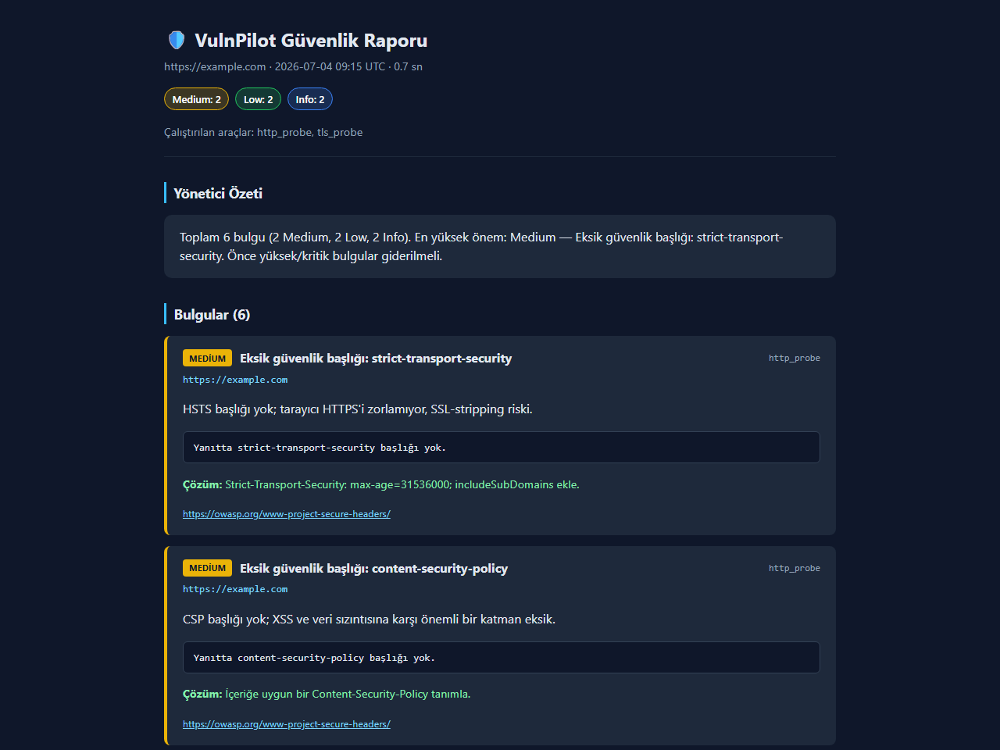
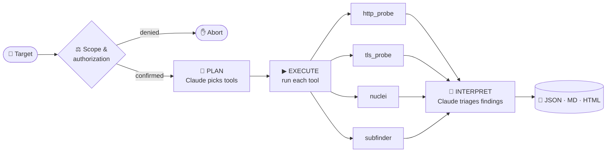

<div align="center">

# 🛡️ VulnPilot

### An AI co-pilot for web security scanning

**Claude plans the scan, battle-tested tools do the detection, Claude writes the report.**

[](https://github.com/yavuzscnplt/vulnpilot/actions/workflows/ci.yml)


[How it works](#-how-it-works) · [Quick start](#-quick-start) · [Sample report](#-sample-report) · [Architecture](#-architecture) · [Roadmap](#-roadmap) · [Türkçe](#-türkçe-özet)



<sub>A real VulnPilot report — one self-contained HTML file. <a href="examples/sample-report.md">See the Markdown version →</a></sub>

</div>

---

## 💡 Why VulnPilot?

Running a security scan is easy. Knowing **which** tools to run, and turning a
pile of raw output into something a developer or manager can act on, is the hard part.

VulnPilot is a **security orchestrator, not yet another scanner**. It doesn't
reinvent detection engines. It lets proven open-source tools
([nuclei](https://github.com/projectdiscovery/nuclei),
[subfinder](https://github.com/projectdiscovery/subfinder)) and its own
lightweight probes do the detection, and adds a reasoning layer on top:

| Without VulnPilot | With VulnPilot |
|---|---|
| Decide by hand which tools fit the target | 🧠 Claude picks a safe plan from what's installed |
| Run each tool, juggle output formats | ▶ One command runs them and normalizes every finding |
| Read hundreds of lines of raw output | 📝 Executive summary + prioritized fix list |
| Copy/paste results into a document | 📄 JSON, Markdown and single-file HTML, ready to share |

---

## ✨ Highlights

- **🧠 AI planning and triage.** Claude chooses tools per target and writes the
  executive summary. The planner prompt forbids destructive, DoS and brute-force actions.
- **🔌 Works with no API key.** Without `ANTHROPIC_API_KEY` it switches to a
  deterministic heuristic mode, so anyone can clone it and run a full scan.
- **🧩 Plugin architecture.** A new tool is one file: subclass `Tool` and add `@register`.
  The CLI, planner and reports pick it up automatically.
- **🪂 Degrades gracefully.** Missing external binaries are skipped. Built-in
  Python probes still produce findings on a bare install.
- **⚖️ Authorization first.** No traffic is sent until you confirm you are allowed
  to test the target. Local and private targets are labeled as self-tests.
- **📄 Shareable reports.** JSON for pipelines, Markdown for tickets, and an HTML
  report with all CSS inlined, so you can attach a single file.
- **✅ Tested and linted in CI.** pytest + ruff on Python 3.10, 3.11 and 3.12. Tests
  need no network or external tools.

---

## 🔁 How it works



1. **Scope.** The target is normalized and validated, then you confirm you are authorized.
2. **Plan.** Claude sees the target and the tools available on *this* machine and
   returns a JSON plan with a rationale. Unknown tool names are dropped; if the
   answer is invalid, it falls back to running all safe tools.
3. **Execute.** Each chosen tool runs and returns typed `Finding` objects
   (severity, evidence, remediation, references).
4. **Interpret.** Claude acts as a senior pentester: it writes a risk-level summary
   with business impact and orders the fixes by priority.

---

## 🧰 Built-in & integrated tools

| Tool | Type | What it checks | Needs |
|------|------|----------------|-------|
| `http_probe` | built-in | Missing security headers (HSTS, CSP, X-Frame-Options, X-Content-Type-Options, Referrer-Policy), insecure cookie flags (`Secure` / `HttpOnly`), tech disclosure (`Server`, `X-Powered-By`, …) | nothing |
| `tls_probe` | built-in | Plain-HTTP targets, failed certificate validation, legacy protocols (SSLv2/3, TLS 1.0/1.1), expired or soon-to-expire certificates | nothing |
| `nuclei` | external | Known CVEs, misconfigurations and exposures from the nuclei template library | [`nuclei`](https://github.com/projectdiscovery/nuclei) |
| `subfinder` | external | Passive subdomain discovery | [`subfinder`](https://github.com/projectdiscovery/subfinder) |

---

## 🚀 Quick start

```bash
git clone https://github.com/yavuzscnplt/vulnpilot.git
cd vulnpilot
pip install -e .            # core: typer, rich, httpx

vulnpilot tools             # see which tools are ready on this machine
vulnpilot scan http://localhost:8080 --yes --open   # scan your own app
```

**Turn on the AI brain (optional):**

```bash
pip install -e ".[ai]"
cp .env.example .env        # then set ANTHROPIC_API_KEY
```

**Add deeper scanning (optional, needs Go):**

```bash
go install github.com/projectdiscovery/nuclei/v3/cmd/nuclei@latest
go install github.com/projectdiscovery/subfinder/v2/cmd/subfinder@latest
```

### CLI

| Command | Description |
|---|---|
| `vulnpilot scan <url>` | Scan a target (asks for authorization first) |
| `vulnpilot scan <url> -y` | Skip the prompt. **Only for targets you are allowed to test.** |
| `vulnpilot scan <url> -o ./out` | Write reports to a custom folder |
| `vulnpilot scan <url> --open` | Open the HTML report in your browser when done |
| `vulnpilot tools` | List registered tools and whether they're installed |
| `vulnpilot version` | Print the version |

Reports are saved as `reports/<host>_<timestamp>.{json,md,html}`.

### What a run looks like

```text
╭───────────────────────────────╮
│ VulnPilot v0.1                │
│ AI-orkestralı web güvenlik... │
╰───────────────────────────────╯

Hedef: http://localhost:8080  (lokal/özel)
Kullanılabilir araçlar: http_probe, tls_probe
AI beyni: açık

  🧠 AI araç planı çıkarıyor
  📋 http_probe, tls_probe
  ▶ http_probe
  ✓ http_probe: 4 bulgu
  ▶ tls_probe
  ✓ tls_probe: 1 bulgu
  📝 AI özet/triaj yazıyor
```

> The CLI and reports are in Turkish today. Localization is on the roadmap.

### Configuration

All settings come from environment variables or `.env` (see [`.env.example`](.env.example)):

| Variable | Default | Purpose |
|---|---|---|
| `ANTHROPIC_API_KEY` | *(empty)* | Turns on the AI brain. Empty means heuristic mode. |
| `VULNPILOT_MODEL` | `claude-sonnet-5` | Claude model used for planning and triage |
| `VULNPILOT_HTTP_TIMEOUT` | `15` | HTTP probe timeout (s) |
| `VULNPILOT_TOOL_TIMEOUT` | `180` | Per-tool timeout for external binaries (s) |
| `VULNPILOT_OUTPUT_DIR` | `reports` | Report output folder |

---

## 📄 Sample report

Every scan writes three formats from the same `ScanReport` model:

- **HTML.** Dark theme, severity badges, evidence blocks and fix suggestions. One file, no external assets.
- **Markdown.** Drops into a GitHub issue, Jira ticket or wiki page. [Example →](examples/sample-report.md)
- **JSON.** Machine-readable, with severity counts, plan rationale and per-tool timings.

Findings are sorted **Critical → High → Medium → Low → Info**, and each one includes
the tool that found it, the evidence, the remediation and references (OWASP etc.).

---

## 🏗 Architecture

```text
vulnpilot/
├── cli.py           # Typer + Rich terminal UI
├── config.py        # env-based settings
├── scope.py         # target validation + authorization guard (the ethical backbone)
├── llm.py           # Claude "brain": plan() + summarize(), with heuristic fallback
├── orchestrator.py  # plan → execute → interpret loop
├── models.py        # typed dataclasses: Target, Finding, ToolResult, ScanReport
├── report.py        # JSON / Markdown / self-contained HTML renderers
└── tools/           # plugins, self-registered via @register
    ├── base.py      # Tool ABC, registry, subprocess + timing helpers
    ├── http_probe.py
    ├── tls_probe.py
    ├── nuclei.py
    └── subfinder.py
```

### Adding a tool takes one file

```python
from vulnpilot.models import Finding, Severity, Target, ToolResult
from vulnpilot.tools.base import Tool, register


@register
class RobotsProbe(Tool):
    name = "robots_probe"
    description = "Reads robots.txt for hidden paths"   # the AI planner sees this
    binary = ""                                          # "" = pure Python, always available

    def run(self, target: Target) -> ToolResult:
        ...
        return ToolResult(tool=self.name, target=target.url, ok=True,
                          duration_s=0.1, findings=[...])
```

Then import it in `vulnpilot/tools/__init__.py`. It appears in `vulnpilot tools`,
the planner can choose it, and its findings show up in every report format.

### Design principles

| Principle | How it shows up in the code |
|---|---|
| **Orchestrate, don't reinvent** | External scanners are thin wrappers. VulnPilot adds planning and judgement. |
| **AI is optional, never required** | Every `Brain` call has a deterministic fallback, and invalid LLM output is caught. |
| **The model can't go off-script** | The planner can only pick from tools that are installed; anything else is filtered out. |
| **Authorization first** | `scope.authorize()` runs before any network traffic. |
| **Zero-dependency data layer** | Plain `dataclasses` with no ORM or pydantic, so JSON serialization is trivial. |

---

## 🧪 Development

```bash
pip install -e ".[dev]"
pytest          # unit tests, no network or external tools needed
ruff check .    # lint (E, F, I, UP, B)
```

CI runs both on every push and PR across Python 3.10 – 3.12.

---

## 🗺 Roadmap

- [ ] OWASP ZAP integration for active scanning
- [ ] REST / GraphQL endpoint discovery and fuzzing
- [ ] Run tools in parallel
- [ ] Autonomous agent mode (AI proposes and runs its own payloads, in scope only)
- [ ] SARIF output for GitHub code scanning and CI/CD gates
- [ ] English / Turkish localization for CLI and reports

Ideas and PRs are welcome. Open an issue first for larger changes.

---

## ⚠️ Legal & responsible use

VulnPilot is for **authorized security testing only**. Run it only against systems
you own or have **explicit written permission** to test. Unauthorized scanning
is illegal in many countries, and you are responsible for how you use it.
See [SECURITY.md](SECURITY.md) for reporting vulnerabilities in VulnPilot itself.

---

## 🇹🇷 Türkçe özet

**VulnPilot**, web uygulamaları için yapay zekâ destekli bir güvenlik tarama
orkestratörü. Claude hedefe göre hangi araçların çalışacağını planlıyor.
nuclei, subfinder ve dahili HTTP/TLS probe'ları taramayı yapıyor. Ardından
Claude ham bulguları yönetici özetine ve öncelikli bir düzeltme listesine
çeviriyor. Çıktı JSON, Markdown ve tek dosyalık HTML rapor olarak kaydediliyor.

- API anahtarı olmadan da çalışır (kural tabanlı mod).
- Yeni araç eklemek tek dosya: `Tool` sınıfından türet, `@register` ekle.
- Hedefe trafik gitmeden önce mutlaka yetki onayı ister.
- **Yalnızca sahibi olduğun ya da yazılı izin aldığın sistemlerde kullan.**

```bash
pip install -e .
vulnpilot scan http://localhost:8080 --yes --open
```

---

<div align="center">

MIT © [Yavuz Canpolat](https://github.com/yavuzscnplt) · Built with Python, Rich, httpx and Claude

</div>
